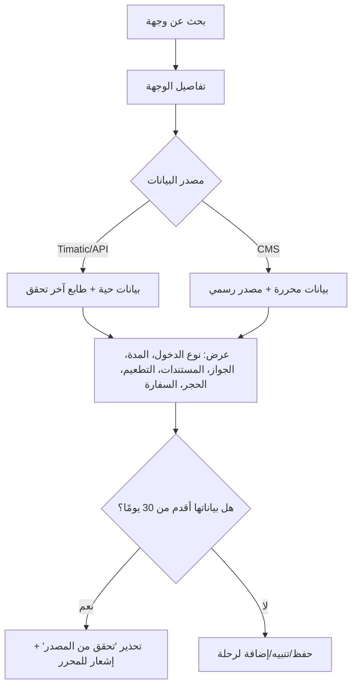

# سفرنا — دليل المسافر السعودي: المنتج وتدفقات المستخدم

> اللغة الأساسية: العربية (RTL) مع إنجليزية اختيارية. الأولوية للجوال (Mobile-first).

## 1) الشخصيات المستهدفة
| الشخصية | الحاجة الرئيسية |
|---|---|
| رب أسرة (35–50) | معرفة مستندات الدخول للجميع (أطفال/مرافقين) وتجنب الرفض في المطار |
| شاب/ة (20–30) | وجهات اقتصادية بدون تأشيرة، خطة رحلة سريعة |
| مقيم بجواز سعودي/إقامة | الفرق بين شروط الجواز والإقامة |

## 2) خريطة الشاشات
الترحيب (3 خطوات + تخصيص) ← الرئيسية ← استكشف (بحث+فلاتر) ← تفاصيل الوجهة (نظرة عامة | شروط الدخول | مراجعات) ← رحلاتي (مخطط أيام) ← المفضلة ← أدوات (محوّل عملات، تنبيهات، إعدادات).

## 3) تدفق التحقق من شروط الدخول (الأهم)

## 4) تدفق التنبيهات
مستخدم يتابع وجهة ← تغيّر سجل الشروط (Webhook من Timatic أو تعديل CMS) ← مقارنة Diff ← طابور مهام ← Push + بريد: «تغيّرت شروط {الوجهة}: {ملخص}».

## 5) تدفق الرحلة
اختيار وجهة ← تاريخ ومدة ← خطة أيام ← تذكير تلقائي بإجراءات التأشيرة (T-30 / T-7) ← روابط حجز (أفلييت) ← تصدير/مشاركة.

## 6) Wireframes (نصية — النسخة العالية الدقة موجودة في `/app`)
```
┌ الرئيسية ───────────┐   ┌ تفاصيل الوجهة ──────┐
│ [سفرنا]  🌙 EN      │   │   🕌 تركيا          │
│ ┌────────────────┐ │   │ [حفظ][أضف][نبّهني]  │
│ │إلى أين وجهتك؟  │ │   │ شروط الدخول|نظرة|مراجعات│
│ │[ابحث….....][بحث]│ │   │ نوع الدخول: بدون تأشيرة│
│ └────────────────┘ │   │ المدة/الجواز/التطعيم  │
│ بدون تأشيرة مسبقة   │   │ المستندات ✓ ✓ ✓      │
│ [بطاقة][بطاقة]     │   │ السفارة 📞           │
│ مقترحة لك           │   │ آخر تحقق + المصدر    │
└ 🏠 🧭 🗓️ ❤️ 🧰 ──────┘   └──────────────────────┘
```
## 7) UI Kit (مطبّق في `app/styles.css` كمتغيرات CSS)
- الألوان: أخضر `#0B6B4F`، ذهبي `#C9A24B`، رملي `#F7F3EA`؛ حالات: نجاح/تحذير/خطر (مع نص لا لون فقط).
- الخط: Tajawal (400/500/700/800). الأيقونات: رموز واضحة + نص.
- مكوّنات: بطاقة وجهة، شارة تأشيرة، Chips فلاتر، Tabs، Bottom-Tab-Bar، Toast، نماذج، قائمة مستندات.
- حركة: انتقال 150–250ms، تُعطَّل مع `prefers-reduced-motion`.
- الهوية البصرية: بدون صور أشخاص؛ ألوان ورموز محايدة ومحتشمة؛ دعم الوضع الداكن.

## 8) إمكانية الوصول (WCAG 2.2 AA)
تباين ≥ 4.5:1، أهداف لمس ≥ 44px، `lang`/`dir` صحيحة، روابط تخطّي، `aria-live` لنتائج البحث والتنبيهات، `aria-pressed` للفلاتر والمفضلة، تركيز ظاهر، دعم لوحة المفاتيح، احترام تقليل الحركة، لا اعتماد على اللون وحده.
