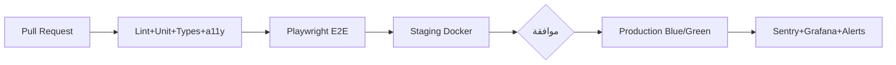

# خطة التنفيذ والنشر والتقديرات

## الفريق المقترح
PM، مصمم UX/UI، مطوّر Frontend ×2، Backend ×2، DevOps (جزئي)، QA ×1، محرر محتوى/خبير تأشيرات ×1.

## الجدول الزمني (≈ 24 أسبوعًا حتى الإطلاق العام)
| المرحلة | الأسابيع | المخرجات |
|---|---|---|
| 0. اكتشاف وبحث | 1–2 | مقابلات 15 مسافرًا، تحديد مصدر Timatic/بدائل، المتطلبات القانونية (PDPL) |
| 1. تصميم | 2–5 | تدفقات، Wireframes، نظام تصميم، نموذج تفاعلي، اختبار قابلية الاستخدام |
| 2. MVP أساسي | 5–12 | كتالوج الوجهات، شروط الدخول، بحث وفلاتر، حساب، مفضلة، PWA دون اتصال، CMS |
| 3. الميزات الذكية | 12–18 | توصيات، رحلات، مراجعات + إشراف، محوّل عملات، تنبيهات Push/بريد، خرائط |
| 4. التكاملات | 14–20 | Timatic/مزوّد التأشيرات، طيران/فنادق/أفلييت، تحليلات |
| 5. جودة وأمان | 20–23 | اختبار أداء وأمان (Pen-test)، WCAG، تحميل، تجربة بيتا مغلقة (200 مستخدم) |
| 6. إطلاق | 23–24 | نشر تدريجي (10%→50%→100%)، مراقبة، Runbook |

## تقدير الجهد (إجمالي ≈ 1,900–2,300 ساعة)
| البند | ساعات |
|---|---|
| UX/UI ونظام التصميم | 260 |
| Frontend (PWA، RTL، i18n) | 520 |
| Backend + قاعدة البيانات + API | 460 |
| لوحة CMS وسير العمل | 220 |
| التكاملات (Timatic، دفع/أفلييت، خرائط، FX) | 260 |
| الإشعارات والتنبيهات | 90 |
| QA وأتمتة الاختبارات | 260 |
| DevOps/أمان/مراقبة | 160 |
| إدارة المشروع | 120 |
| احتياطي مخاطر 15% | ~300 |

## التكلفة التشغيلية الشهرية التقريبية (بداية)
استضافة وقاعدة بيانات ≈ 300–600$، CDN ≈ 50$، بحث ≈ 50–100$، بريد/Push ≈ 50$، خرائط حسب الاستخدام، **ترخيص Timatic/API التأشيرات: تفاوضي (أكبر بند)**.

## خطة النشر

- بيئات: dev / staging / prod؛ البنية كشيفرة (Terraform)؛ أسرار في Vault/Secrets Manager.
- قاعدة البيانات: نسخ احتياطي يومي + PITR، ترحيلات عبر Prisma/Flyway.
- إصدار تدريجي بـ Feature Flags؛ تراجع في أقل من 5 دقائق.
- SLO: توفر 99.9%، P95 API < 300ms. مناوبة وRunbook للحوادث.

## المخاطر
| الخطر | التخفيف |
|---|---|
| خطأ في شروط الدخول | مصدران + مراجعة بشرية + طابع «آخر تحقق» + إخلاء مسؤولية |
| تكلفة/ترخيص Timatic | البدء بـ CMS مع مصدر رسمي ثم التكامل التدريجي |
| قيود إقامة البيانات | استضافة داخل المملكة/إقليمية |
| إساءة المراجعات | إشراف مسبق + تبليغ + حدود معدّل |
